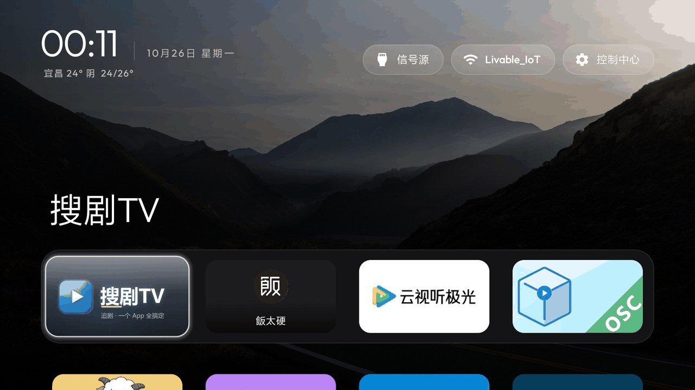
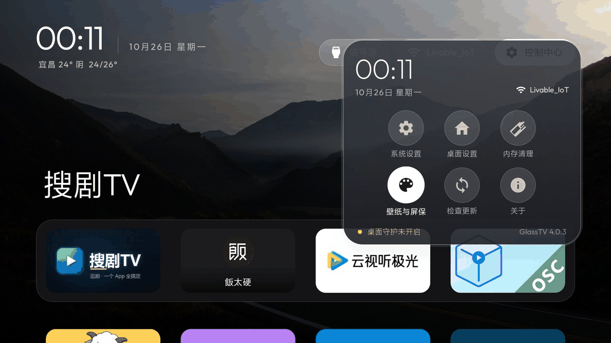
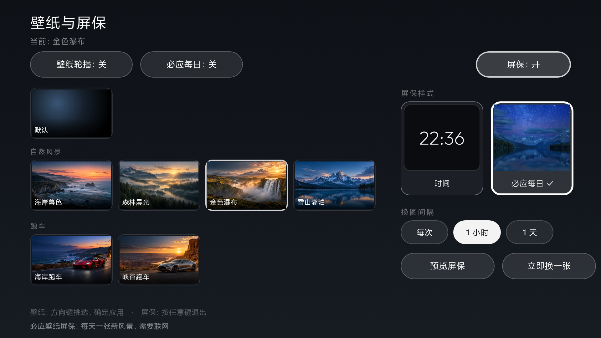
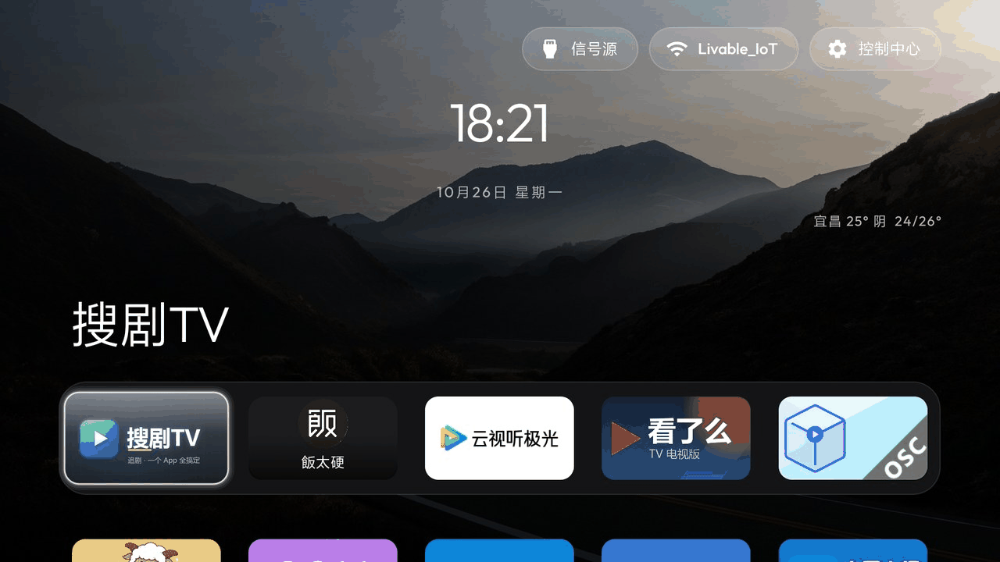

# GlassTV · 玻璃桌面

**给电视一块干净的玻璃桌面。** 没有广告位，没有推荐流，只有你的 App、你选的壁纸、和时钟屏保。

> ### 4.0.0 起正式改名 GlassTV
>
> 本仓库原名 `cleanyourtv-k`，从 **4.0.0** 起统一改名为 **GlassTV（玻璃桌面）**：
> 仓库、官网、应用显示名、安装包文件名全部换新，包名同步改为 `com.glasstv.tvhome`。
> 历史版本的 Release 与更新记录保持原样，不作改动。
>
> 因为包名变了，GlassTV 与旧版可以并存；旧版布局不会自动迁移，建议确认新版没问题后再卸载旧版。

> 本仓库是开源电视桌面 [Gathin23/cleanyourtv](https://github.com/Gathin23/cleanyourtv) 的中文二次开发版，
> 融合了 [BeatsAD/quiet-tv](https://github.com/BeatsAD/quiet-tv)（壁纸模块，MIT）、
> [mclhm8182/tvhome-zh](https://github.com/mclhm8182/tvhome-zh)（必应每日壁纸）、
> [pengchujin/aerial-tv](https://github.com/pengchujin/aerial-tv)（桌面守护 / 一键更新 / 天气 / 返回键回顶）的功能。
>
> 小米国行电视实测可用（MiTV-ASTP0 / Android 9），理论上所有 Android TV 4.4+ 都能跑。

- 官网：**https://tv.jichun29.cn**（静态站，源码在 [glasstv-site](https://github.com/jichun29/glasstv-site)，本仓库 `site/` 是同一份）
- 源码：https://github.com/jichun29/glasstv
- 下载：见 [Releases](https://github.com/jichun29/glasstv/releases)

## 让 AI 帮你装（最省事）

不想自己敲命令？把下面这段话整段复制，发给能在电脑上跑命令的 AI 助手（Claude Code、Codex、Trae、豆包电脑版等），电脑和电视连同一 Wi-Fi 就行：

```text
请帮我把开源电视桌面 GlassTV 装到我的电视上，并设为开机进入的桌面。
项目地址：https://github.com/jichun29/glasstv
请先完整读完仓库里的 PROMPT.md（安装说明）再动手：tools/ 和 launcher/ 直接复用，不用从头写。
我的电视型号是：____（填你的型号）

要求：在我的电脑上亲自运行命令，不要只把步骤告诉我；需要我在电视上操作时提醒我；
装完后把验证命令的原始输出贴给我。
```

完整指令词（英文原文，AI 直接读）在 [PROMPT.md](PROMPT.md)。开始前记得在电视上打开开发者选项里的 USB/网络调试（设置 → 关于 → 连按「版本号」7 次 → 开发者选项 → 打开调试）。

## 截图

全部为小米电视 MiTV-ASTP0 真机实拍：

| 桌面 | 控制中心 | 壁纸选择 |
|:---:|:---:|:---:|
|  |  |  |
| 壁纸 + 大号时间天气 + 应用栏 | 九宫格入口，从信号源到检查更新 | 4 列缩略图，按分组挑选 |

| 桌面设置 | 壁纸页全貌 |
|:---:|:---:|
|  |  |
| 布局 / 外观 / 时间与天气 / 动效 | 默认壁纸 + 四组共 11 张 |

## 功能

### 首页

- **大号时钟 + 天气**：壁纸上显示时间、日期、天气（城市 温度 天气 低/高温，免 key 接口国内直连）。往下滚动时时钟淡出。
- **字号三档**：标准 / 大 / 特大，日期与天气按比例跟随（桌面设置 → 时间与天气）。
- **应用网格**：每行应用数量 4~7 可调，应用栏下方保留 0~3 行。
- **应用全收录**：标准 TV 入口和手机入口都会显示，小米的「应用中心」「高清播放器」这类没标准入口的系统 App 也在。
- **返回键**：在网格里按返回回到第一行；在第一行再按返回进入时钟屏保。

### 控制中心

右上角一个胶囊按钮，滑出毛玻璃面板：

- 第一排：信号源 / 网络 / 系统设置
- 第二排：桌面设置 / 屏保 / 壁纸
- 第三排：内存清理 / 检查更新 / 关于
- 顶部显示时间日期与 WiFi 名，底部提示桌面守护状态 + 版本号

### 壁纸

- **11 张内置壁纸**：自然风景 4（海岸暮色 / 森林晨光 / 金色瀑布 / 雪山湖泊）、跑车 2、卡通场景 2、清简风景 3。
- 整屏 4 列缩略图网格，焦点停在哪张就用哪张做背景预览，OK 应用、返回不改。
- 壁纸轮播（默认关）、必应每日（默认关）两个开关。

### 时间与天气（桌面设置）

- **字号**：标准 / 大 / 特大。
- **天气城市**：点开输入框手填，留空 = 自动定位（需给应用位置权限）。
- **背景颜色**：纯黑 / 午夜蓝 / 酒红 / 石板灰（壁纸关掉或缺图时才看得见）。

### 菜单键 = 应用菜单

选中 App 按遥控器「菜单 ≡」键：**打开 / 从主屏幕隐藏 / 置顶 / 移动位置 / 卸载 / 应用信息**。

### 自动清理内存

按间隔清理后台进程，可设白名单保住要常驻的应用，也能随时手动清一次。

### 快传

桌面开一个局域网网页，手机扫码把 APK 直接推进电视，不用 U 盘。

### 桌面守护

小米等国行固件待机时会强杀第三方桌面，醒来露出自带广告桌面。桌面守护（无障碍服务）盯着窗口切换：原生桌面一冒头就把 GlassTV 拉回来。只盯窗口、不读内容、不拦按键。

装上后需 adb 开一次（一次性）：

```bash
adb shell settings put secure enabled_accessibility_services com.glasstv.tvhome/com.glasstv.tvhome.HomeGuardService
adb shell settings put secure accessibility_enabled 1
```

### 一键更新

控制中心 → 检查更新：查到新版本后点「下载并安装」，应用内下完 APK 直接交系统安装器，装完自动重启桌面。不用开电脑、不用跳浏览器。

- 数据源只读本仓库 Releases，不联网第三方、不上报任何数据
- 自动检查默认关闭，开了每 3 小时查一次
- GitHub 直连失败时自动切换 ghfast.top / ghproxy.net / gh-proxy.com 加速源
- 「跳过此版」：同一版不再提醒

### 时钟屏保

闲置 5 分钟自动进入（可配），大号时钟每分钟漂移换位置换色，不会烧屏。任何按键退出。

### 防烧屏 & 电视安全

- 屏保时钟每分钟漂移 + 换色
- 弹窗/面板都是临时悬浮，按返回即销毁
- 不写系统亮度等关键设置，不和厂商画质模式打架
- 1GB 内存的电视也不崩：壁纸后台解码、按屏幕尺寸降采样、内存紧张自动释放

## 下载

到 [Releases](https://github.com/jichun29/glasstv/releases/latest) 下载，**按设备选一个**：

| 安装包 | 支持系统 | 说明 |
|---|---|---|
| `GlassTV-Launcher-universal.apk` | **Android 5.0+** | 通用版，功能完整，绝大多数电视/盒子用这个 |
| `GlassTV-Launcher-lite44.apk` | **Android 4.4+** | 4.4 精简版，砍必应每日壁纸、视频壁纸、在线壁纸（4.4 缺相关接口），其余全保留 |

两个版本签名一致，可互相覆盖安装不丢设置。

## 安装

全程不需要 root，**不卸载、不停用任何系统应用**，随时一条命令还原。

### 第一步：打开电视的 ADB 调试

电脑和电视连同一个网络。先在电视上找到 IP（一般在「设置 → 网络」或「关于」里），再开 ADB：

| 电视 | 怎么打开 |
|---|---|
| **小米 / Redmi**（PatchWall、HyperOS） | 设置 → 账号与安全 → **ADB 调试** 打开；同一页的 **安装未知来源的应用** 也打开 |
| **TCL / 雷鸟** | 设置 → 关于 → **本机信息**，遥控器依次按 **上、下、左、右**，底部出现隐藏分组，选中 **ADB** 按确认 |
| **原生 Android TV / Google TV**、海信等 | 设置 → 设备偏好 → 关于 → 连按 **版本号** 7 次开开发者选项；再到 开发者选项 → **USB 调试** 打开 |

更全的品牌列表（华为/创维/长虹/康佳/极米等）见 [docs/tv-adb-guide.md](docs/tv-adb-guide.md)。

电脑第一次连接时电视上会弹「允许 USB 调试吗」，选 **允许**（勾「始终允许」）。

### 第二步：装桌面

```bash
adb connect <电视IP>:5555
adb install -r GlassTV-Launcher-universal.apk
adb shell cmd package set-home-activity --user 0 com.glasstv.tvhome/.MainActivity
```

按遥控器 Home 键，看到新桌面就成了。

### 第三步（可选）：开桌面守护

小米用户强烈建议开——不然待机后可能回到 PatchWall：

```bash
adb shell settings put secure enabled_accessibility_services com.glasstv.tvhome/com.glasstv.tvhome.HomeGuardService
adb shell settings put secure accessibility_enabled 1
```

### 还原成原来的桌面

```bash
adb shell cmd package set-home-activity --user 0 <原桌面包名>/.<原桌面Activity>
adb shell pm uninstall com.glasstv.tvhome
```

不知道原桌面包名？装之前先记一下：`adb shell cmd package resolve-activity -c android.intent.category.HOME -a android.intent.action.MAIN`

## 从旧版（CleanYourTV 3.x）升级

4.0.0 换了包名，所以是**并行安装**，两个桌面可以同时存在：

```bash
adb install -r GlassTV-Launcher-universal.apk
adb shell cmd package set-home-activity --user 0 com.glasstv.tvhome/.MainActivity
```

确认新版正常后，再卸载旧版：

```bash
adb uninstall com.gathin.tvhome
```

旧版的桌面排序、壁纸选择不会自动迁移（存在各自的私有目录里），需要在 GlassTV 里重新设一次。

## 常见问题

**装完按 Home 没反应 / 又回到原桌面？**
跑一次 `adb shell cmd package set-home-activity --user 0 com.glasstv.tvhome/.MainActivity`。小米装新 App 后默认 Home 会被重置，这是正常现象。开了桌面守护就不会再跑丢。

**待机后醒来变回小米桌面？**
开桌面守护（上面第三步）。小米待机会强杀第三方 App，守护会在原生桌面冒头时把 GlassTV 拉回来。

**天气不显示 / 城市不对？**
桌面设置 → 时间与天气 → 天气城市，填中文城市名（填英文会显示英文，因为天气接口返回的是拼音）；留空则自动定位，需要给应用位置权限。

**电视上没有应用详情页/卸载不了 App？**
国行小米阉割了标准应用详情 Intent。桌面里的「管理/卸载」已做适配：自动跳小米电视管家的应用管理页。

**某些 App 图标没显示名字？**
QQ 音乐、夸克这类 App 没做 TV banner，桌面只能显示图标，这是 App 本身的问题，改不了。

**4.4 老盒子能装吗？**
装精简版（lite44）。Android 5.0 以下没有 TvInputManager 框架，「信号源」按钮降级为打开电视自带的选源面板。

**支持哪些电视？**
实测：小米 MiTV-ASTP0（Android 9）。理论支持所有 Android TV 4.4+。更多机型的适配笔记见 [docs/devices/](docs/devices/)。

## 📢 电视去广告库（174 机型）

仓库自带 [`debloat/`](debloat/) 目录：**174 个电视/盒子/投影机型**的去广告清单，每条注明这个包是干什么的、停用后失去什么。**只停用、不卸载，随时一键还原。**详见 [debloat/README.md](debloat/README.md)。

## 构建

```bash
export JAVA_HOME=/usr/lib/jvm/java-17-openjdk-amd64
export PATH=$JAVA_HOME/bin:$PATH

cd launcher
./gradlew assembleRelease                      # 通用版（minSdk 21）
./gradlew assembleRelease -PliteBuild=true     # 4.4 精简版（minSdk 19）
```

产物：`launcher/app/build/outputs/apk/release/app-release.apk`。

> 必须联网构建：快传二维码依赖 `com.google.zxing:core`，本地无缓存时 `--offline` 会直接失败。

## 致谢

- [Gathin23/cleanyourtv](https://github.com/Gathin23/cleanyourtv) —— 上游桌面本体
- [BeatsAD/quiet-tv](https://github.com/BeatsAD/quiet-tv) —— 壁纸模块来源（MIT License）
- [mclhm8182/tvhome-zh](https://github.com/mclhm8182/tvhome-zh) —— 必应每日壁纸
- [pengchujin/aerial-tv](https://github.com/pengchujin/aerial-tv) —— 桌面守护 / 一键更新 / 天气 / 返回键回顶 的参考实现

## 免责声明

本项目是**第三方开源软件**，与 Apple Inc.（苹果）、小米科技、TCL、海信及任何电视厂商**没有任何关联**，亦非上述公司的官方产品或认可产品。项目中提及的「tvOS」「PatchWall」「小米」「TCL」等名称和商标归其各自所有者所有，仅用于描述兼容性。

本软件按「现状」提供，不附带任何明示或暗示的担保。使用本软件（包括安装、卸载、修改系统设置）产生的一切后果由使用者自行承担。作者不对数据丢失、设备故障或保修失效负责。安装前请自行备份重要数据。

## License

与上游一致（GPL-3.0）。壁纸模块部分遵循 quiet-tv 的 MIT License。
